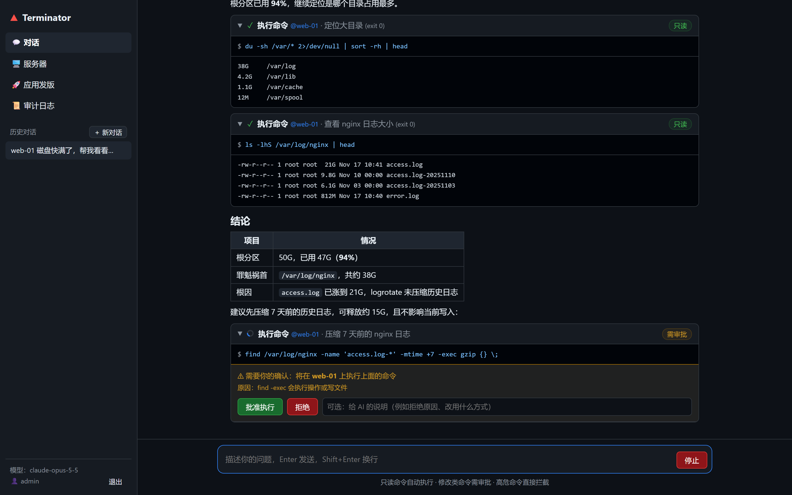
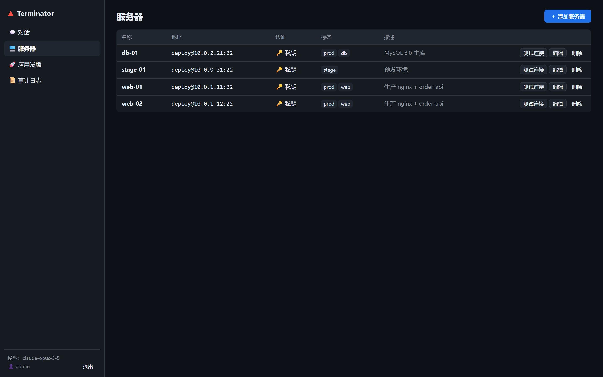
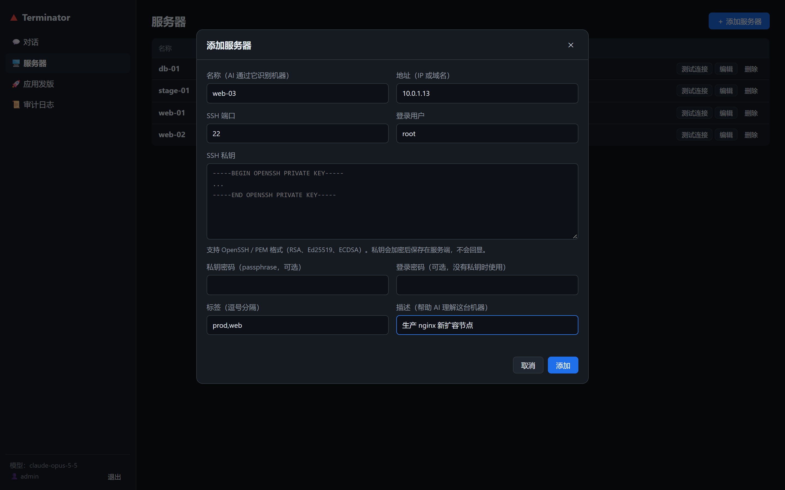
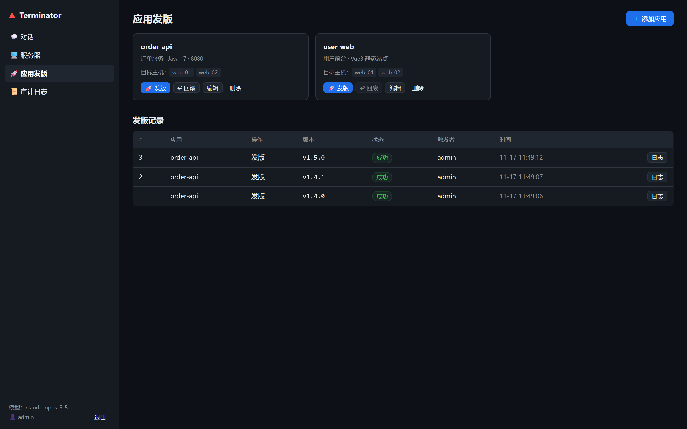
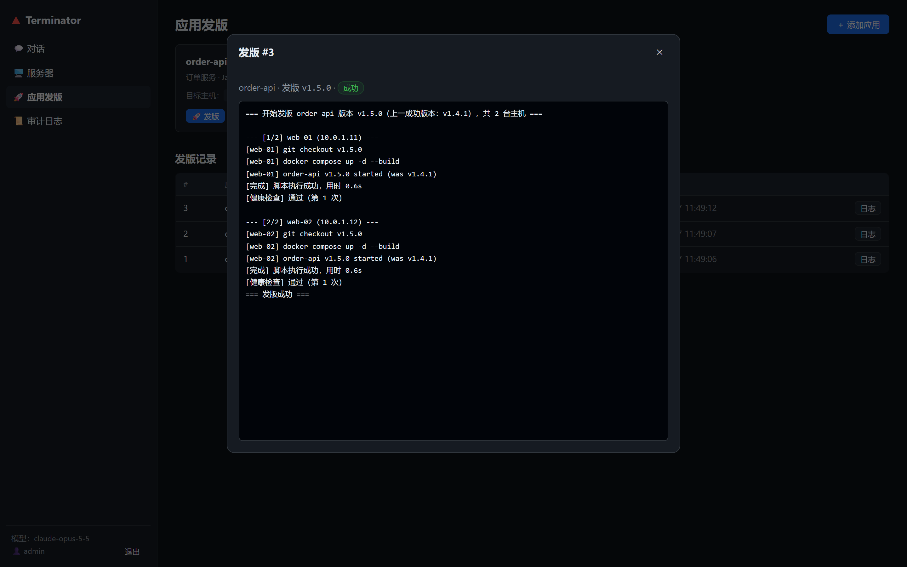
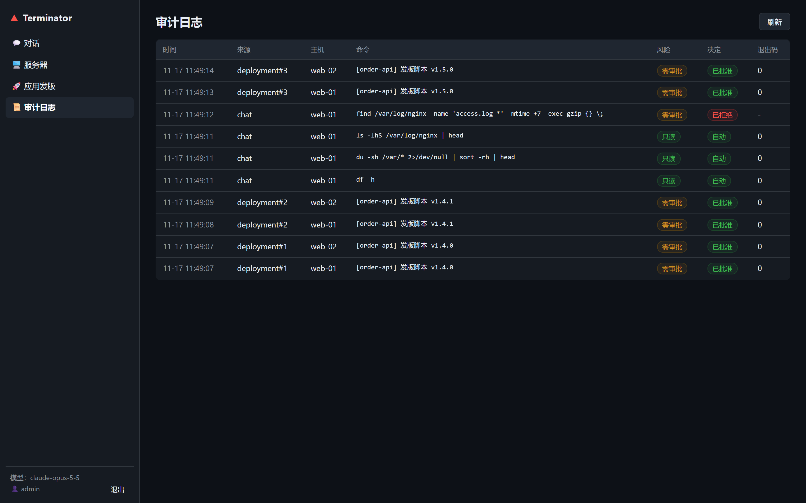
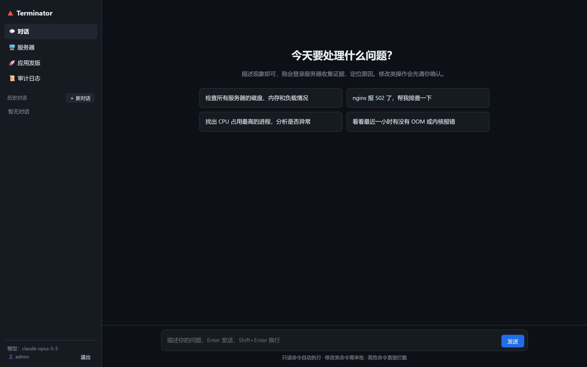

# Terminator · Linux 运维 AI 助手

一个网页版的运维 Agent：用自然语言描述问题，它会**通过 SSH 密钥登录你的服务器**收集证据、定位原因、给出方案，也可以**按预设脚本发版和回滚**。只读命令自动执行，修改类命令必须由你在网页上点「批准」，高危命令直接拦截，所有操作留有审计记录。



## 功能

- **对话排障**：描述现象（"nginx 502 了"、"磁盘快满了"），AI 自主决定在哪台机器上执行什么命令，实时显示命令和输出，最后给出「现象 → 根因 → 方案」。
- **三级命令风控**
  - 🟢 **只读**（`df`、`ps`、`tail`、`journalctl`、`systemctl status`、`docker logs`、`kubectl get` 等）：自动执行
  - 🟡 **需审批**（重启服务、删除/写入文件、`sed -i`、`kill`、安装软件、未知脚本，以及任何无法静态判断的命令）：网页弹出审批卡片，可批准或拒绝，并附一句话给 AI
  - 🔴 **禁止**（`rm -rf /`、`mkfs`、`dd` 写裸盘、fork 炸弹、`chmod -R 777 /` 等）：即使批准也不会执行
- **SSH 密钥登录**：支持 OpenSSH/PEM 私钥（RSA、Ed25519、ECDSA，可带 passphrase），也支持密码。凭据用 `SECRET_KEY` 派生的密钥加密后存入数据库，接口永不回显。
- **多机并行**：一条命令可以同时在多台主机上执行，输出按主机分组。
- **发版 / 回滚**：为每个应用配置发版脚本、回滚脚本和健康检查，按主机**逐台滚动**发布，任意一台失败立即停止。可以在「应用发版」页面手动发，也可以在对话里说"把 order-api 的 v1.5.0 发到生产"（同样需要审批）。
- **审计日志**：记录每条命令的来源、主机、风险等级、决定（自动/批准/拒绝/拦截）、退出码和输出。
- **兼容任意 OpenAI 接口的大模型**：OpenAI、Claude（兼容端点）、DeepSeek、智谱 GLM、通义千问、本地 Ollama/vLLM 均可。

## 截图

| 服务器管理 | 添加服务器（私钥加密保存） |
|---|---|
|  |  |

| 应用与发版记录 | 发版实时日志 |
|---|---|
|  |  |

| 审计日志 | 首页 |
|---|---|
|  |  |

## 快速开始

需要 Python 3.11+，推荐使用 [uv](https://github.com/astral-sh/uv)。

```bash
git clone <本仓库> && cd Terminator-Agent
uv sync

cp .env.example .env
# 编辑 .env，至少填写：
#   SECRET_KEY      随机长字符串（用于加密私钥，务必备份）
#   ADMIN_PASSWORD  管理员密码
#   LLM_BASE_URL / LLM_API_KEY / LLM_MODEL

uv run uvicorn app.main:app --host 0.0.0.0 --port 8000
```

打开 `http://<服务器>:8000`，用 `admin` 和你设置的密码登录。

> 没有设置 `ADMIN_PASSWORD` 时，首次启动会生成随机密码并打印在控制台。
> 没有设置 `SECRET_KEY` 时，会自动生成并保存到 `data/secret.key`。**丢失后，已保存的私钥将无法解密。**

不用 uv 的话：

```bash
python -m venv .venv && source .venv/bin/activate
pip install fastapi "uvicorn[standard]" asyncssh httpx cryptography itsdangerous python-dotenv
uvicorn app.main:app --host 0.0.0.0 --port 8000
```

### 大模型配置示例

| 服务 | `LLM_BASE_URL` | `LLM_MODEL` 示例 |
|---|---|---|
| OpenAI | `https://api.openai.com/v1` | `gpt-4o` |
| DeepSeek | `https://api.deepseek.com/v1` | `deepseek-chat` |
| 智谱 GLM | `https://open.bigmodel.cn/api/paas/v4` | `glm-4-plus` |
| 通义千问 | `https://dashscope.aliyuncs.com/compatible-mode/v1` | `qwen-max` |
| Ollama（本地） | `http://127.0.0.1:11434/v1` | `qwen2.5:14b` |

模型需要支持 function calling / tools。

## 使用

### 1. 添加服务器

「服务器」→「添加服务器」：填写名称（AI 通过名称识别机器，例如 `web-01`）、IP、端口、用户和私钥，然后点「测试连接」。

- 建议使用专门的运维账号，并给它配置最小权限的 sudo。
- 「描述」和「标签」会提供给 AI，写清楚机器用途（例如"生产 nginx + order-api"）能显著提升排障效果。

### 2. 对话排障

在「对话」页直接描述问题，例如：

- `检查所有服务器的磁盘、内存和负载情况`
- `web-01 上 nginx 报 502，帮我排查一下`
- `看看 db-01 最近一小时有没有慢查询或 OOM`

需要审批时会出现黄色卡片，可以批准，也可以拒绝并告诉 AI 原因（例如"现在是业务高峰，晚上再处理"）。随时可以点「停止」中止当前任务。

### 3. 配置应用发版

「应用发版」→「添加应用」：

```bash
# 发版脚本 —— 可用变量：$VERSION $APP $HOST $PREV_VERSION
# 以 set -euo pipefail 运行，任何一步失败即中止本机发版
cd /opt/$APP
git fetch --all --tags
git checkout "$VERSION"
docker compose up -d --build
```

- **回滚脚本**（可选）：`$VERSION` 为回滚目标版本，不指定时默认回到上一个成功发布的版本。
- **健康检查**（可选）：例如 `curl -fsS http://127.0.0.1:8080/health`，退出码 0 视为健康，失败会重试 5 次。
- 目标主机按勾选顺序**逐台**发布，某台失败（脚本报错、超时或健康检查不通过）后，后续主机不再执行。
- 版本号只允许 `A-Z a-z 0-9 . _ - + / : @`，防止命令注入。

## 安全说明

- 风控采用**白名单**：只有能确定是只读的命令才会自动执行，其余一律需要审批。命令先按 `| ; && ||` 和换行拆分并逐段判断；输出重定向、`$()`、反引号、heredoc 都会触发审批；`sudo`、`env`、`timeout`、`nice`、`watch` 等前缀会被剥离后再判断真实命令。
- 风控是**防止 AI 误操作的护栏，不是安全边界**。批准之前请认真看一遍命令。服务器侧请继续使用最小权限账号和 sudo 规则。
- 登录使用 scrypt 哈希加签名 Cookie（HttpOnly、SameSite=Strict），同一 IP 10 分钟内失败 5 次会被锁定。
- **请勿直接暴露到公网**。建议部署在内网，或放在 HTTPS 反向代理加 VPN/SSO 之后。
- 默认不校验 SSH host key（方便内网使用）。生产环境建议设置 `SSH_STRICT_HOST_KEY=true`，并在运行用户的 `~/.ssh/known_hosts` 中写入目标主机。
- 程序**不会**读取运行机器上的 `~/.ssh/config` 或 ssh-agent，只使用面板中录入的凭据。

## 项目结构

```
app/
  main.py      FastAPI 入口：REST 接口、WebSocket（对话 / 发版日志）、静态页面
  agent.py     Agent 主循环：LLM ↔ 工具调用 ↔ 审批 ↔ SSH，系统提示词与工具定义
  risk.py      命令风险分级（只读 / 需审批 / 禁止）
  ssh.py       asyncssh 连接池、流式输出、超时控制
  deploy.py    发版引擎：滚动发布、健康检查、回滚、实时日志订阅
  llm.py       OpenAI 兼容的流式 Chat Completions 客户端（含 tool calls）
  db.py        SQLite 存储（主机、应用、发版、对话、审计）
  auth.py      登录、会话、防爆破
  crypto.py    凭据加密（Fernet）
static/        前端（原生 HTML/CSS/JS，无构建步骤，不依赖外部 CDN）
tests/         pytest 测试（进程内真实 SSH 服务端 + 脚本化假 LLM）
```

## 开发与测试

```bash
uv sync
uv run pytest -q
```

测试会启动一个进程内的 asyncssh 服务端（真实的密钥认证，命令交给本机 `bash` 执行），覆盖 SSH 执行、发版和回滚、Agent 审批流程、Web 接口和 WebSocket，以及 80 多条风控用例。在 Windows 上需要 Git Bash 提供 `bash`。

## 路线图

- [ ] 多用户与角色（只读 / 运维 / 管理员），按主机分组授权
- [ ] 发版审批流（提交 → 他人审批 → 执行）、灰度批次
- [ ] 跳板机（ProxyJump）支持
- [ ] Web 终端（xterm.js）直连
- [ ] 告警接入（Prometheus Alertmanager / 企业微信 / 钉钉 webhook）自动触发排查
